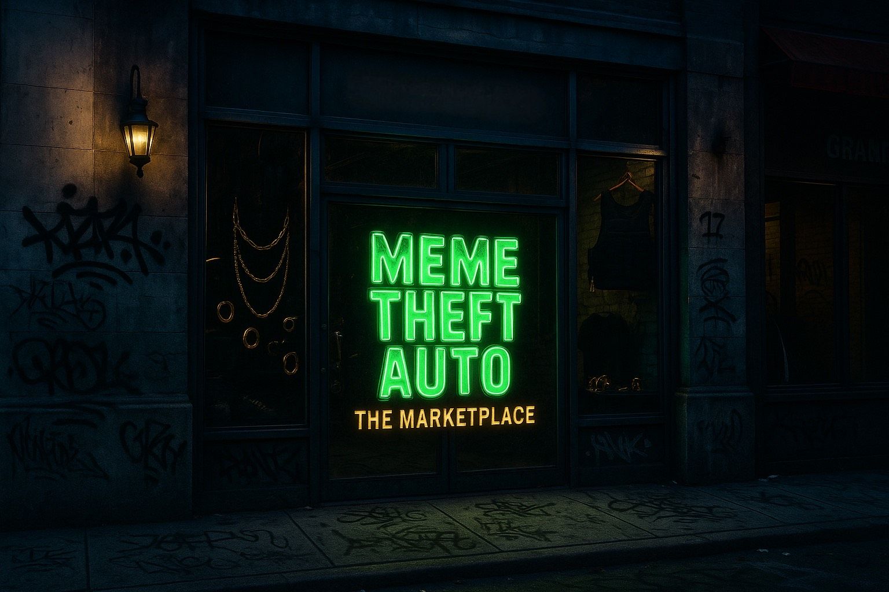

# Unique Burn Mechanism

$MTA has a fixed supply of 1 billion and can only shrink. Meme Theft Auto is a Web4 engine designed to deliver rewards retroactively, and while the rewards may be the main attraction, the burn is what makes the system sustainable. Four things burn tokens:

1. **Marketplace sales where the maker is paid in cash** — 50% of that sale's $MTA is burned and 50% goes to the Treasury.
2. **Trading-pool tokens not needed at listing** — the pool is sized to what the presale raised; the rest is burned.
3. **Community Claim tokens still unclaimed** after the six monthly tranches.
4. **Up to 50% of Round 3's unsold presale tokens.**

No burn is ever reversed, and every burn transaction is posted on-chain. Each one makes the tokens held by early adopters and long-term holders scarcer, and every marketplace drop and every claim window adds to the count.

<figure><figcaption></figcaption></figure>
