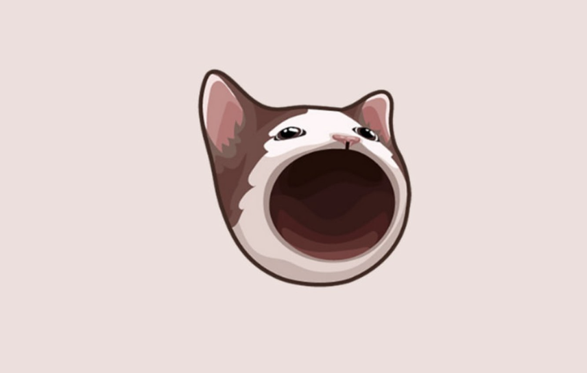
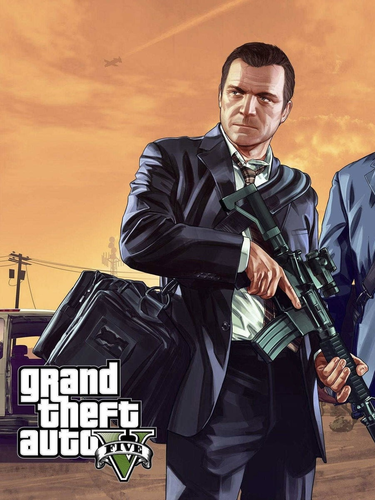
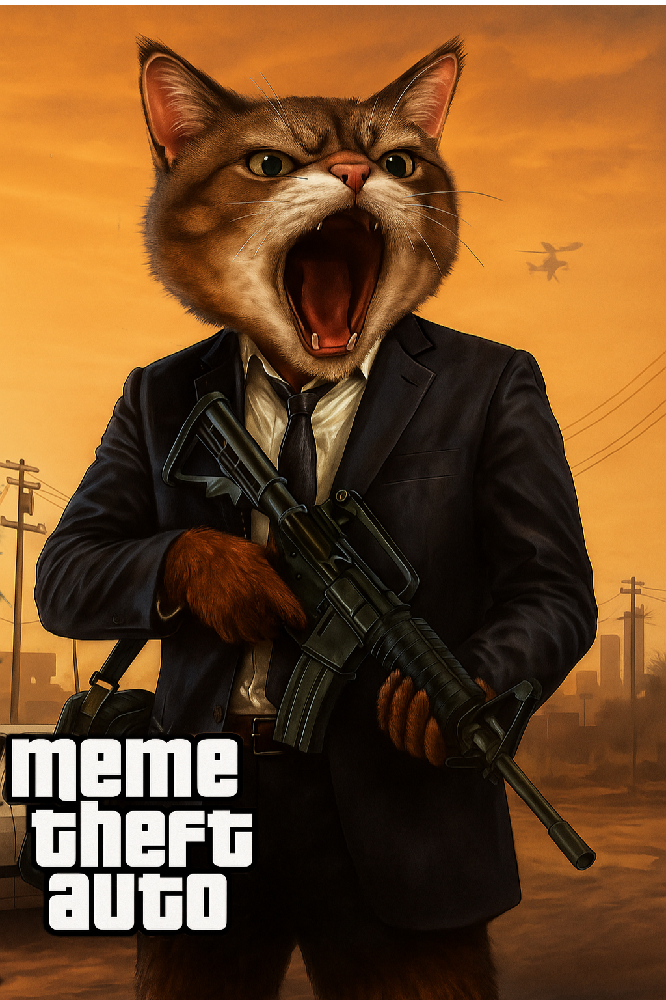

# The Concept

Grand Theft Auto has some of the most recognizable characters in the gaming world, as does top tier coins. Each MTA character was tailored to appeal to GTA players and memecoin traders equally, since both audiences are vital in the success of the project. The characters infused well-known characters & scenes from both realms into harmonious illustrations. With eye catching and familiar elements from both realities, we are confident the art’s familiarity will fuel interest & mass adoption.&#x20;

***

## $POPCAT

<figure><figcaption></figcaption></figure> <figure><figcaption></figcaption></figure> <figure><figcaption></figcaption></figure>


\*\*Disclaimer: _Meme Theft Auto is an original parody developed by Web4 Innovations LLC and is not affiliated with or endorsed by Rockstar Games or Grand Theft Auto._


 
