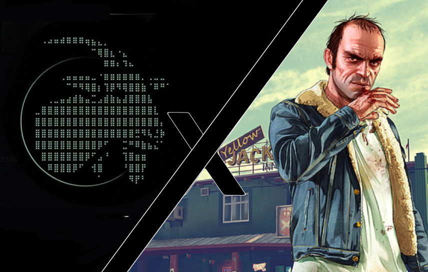

# SB On Them NFTs

Many in the Web3 space know me as SB On Them NFTs. I began my crypto journey in late 2020, drawn to the explosive growth of the NFT market. Eager to learn and succeed, I immersed myself in the space, quickly recognizing a critical gap: effective marketing strategies were essential for projects to thrive.

With a Bachelor of Science in Entertainment Business, with an emphasis in Marketing from Full Sail  University, I leveraged my expertise to fill that need. I initially served as a partnership manager for multiple projects, then expanded my role to include advisory, creative strategy, and conceptual development.

Over the past four years, I’ve contributed to the growth of dozens of Web3 projects, including notable names such as Asset Dash, Stoned Ape Crew, WIDI, and Gainz by GOTM. Collectively, these efforts have generated upwards of eight figures in revenue through minting and secondary sales, attracted hundreds of thousands of investors, and established a robust network of influential players in the Web3 ecosystem. 

I developed Meme Theft Auto from the recognition of yet another critical grab and a belief of the need to usher in the Web4 era… Now Not Later. I’ve seen the commitment that traders have to their “bag” and loyalty to their selected communities, as I have with GTA players dedicating over a decade with the same, if not more, intensity and relentlessness. Our passion to what we deem valuable unites both worlds in a deep yet unrealized accord. I’m a firm believer that those efforts and hours should not go unrewarded.

&#x20;

MTA is the beginning.

<figure><figcaption></figcaption></figure>

<figure><figcaption></figcaption></figure>
