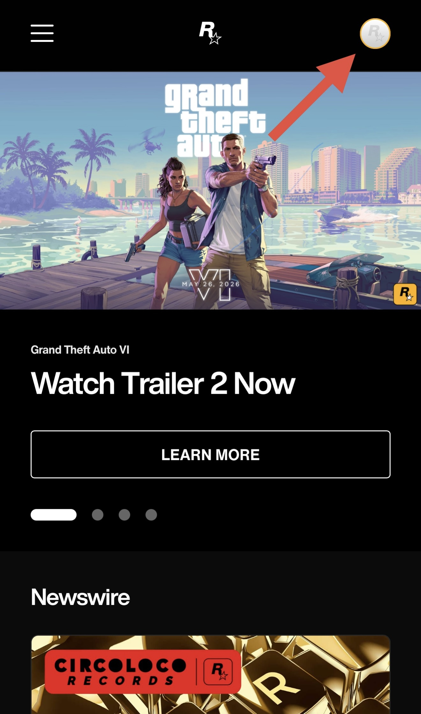
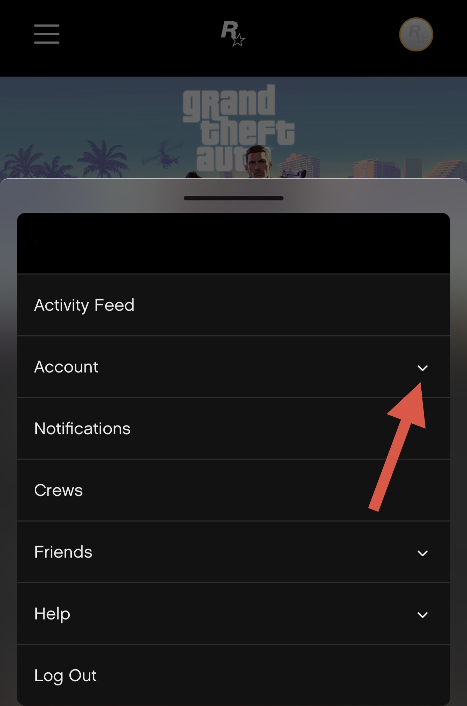
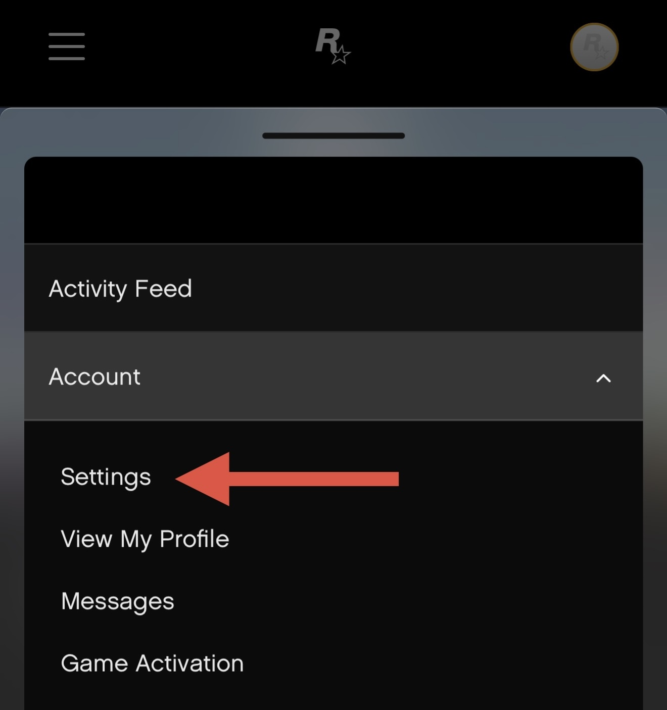
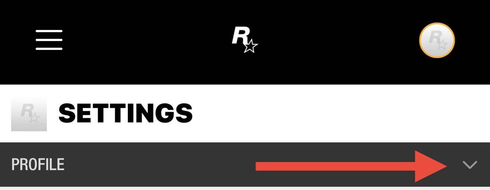
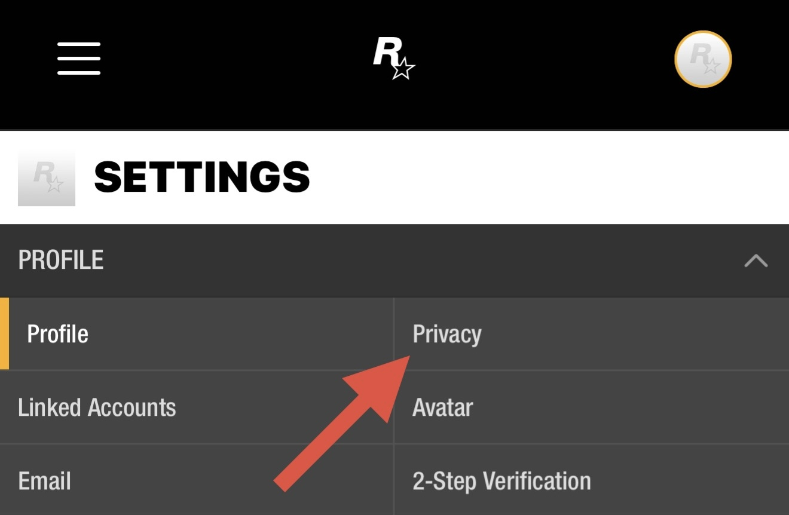
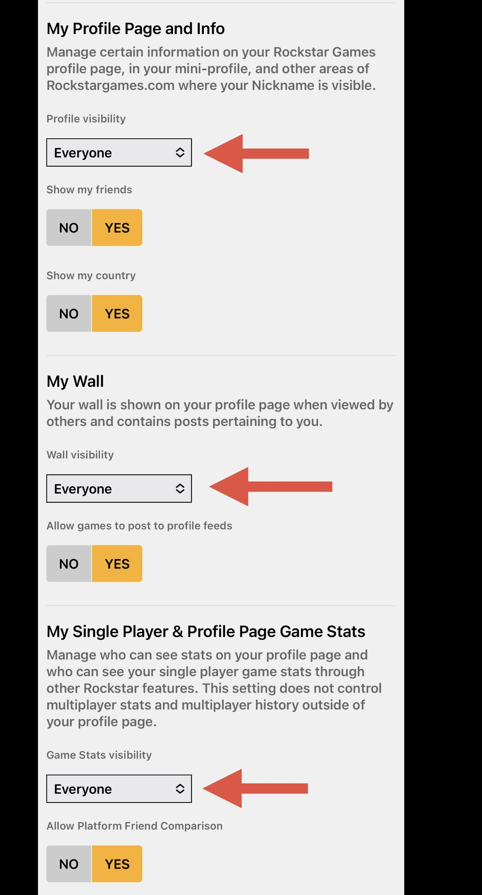

# Rockstar Profile Visibility

#### - Click on profile icon top right corner&#x20;

#### - Navigate to account drop down menu

#### - Click on settings &#x20;

#### - Click profile drop down menu&#x20;

#### - Click on privacy&#x20;

#### - Set visibility of my profile page and info”, “my wall”, and “my single player & profile page game stats” to “Everyone”&#x20;

 
